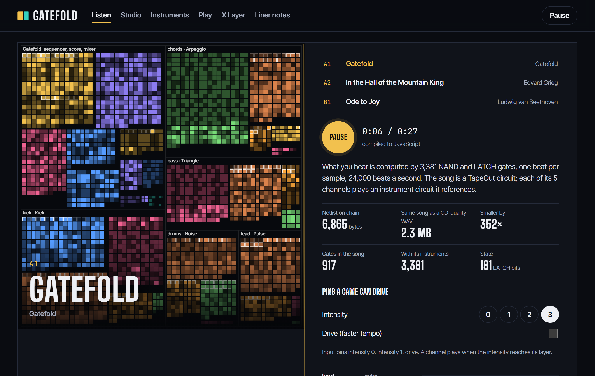
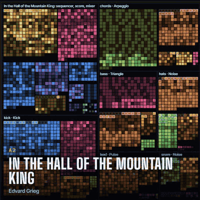
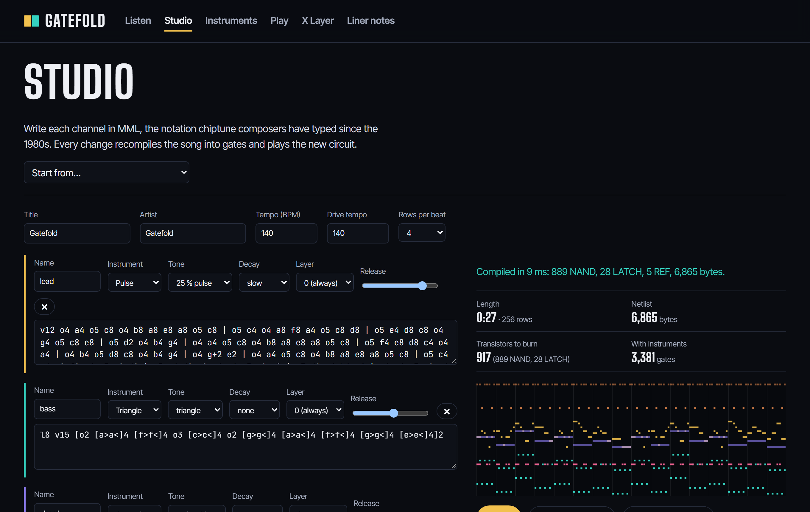
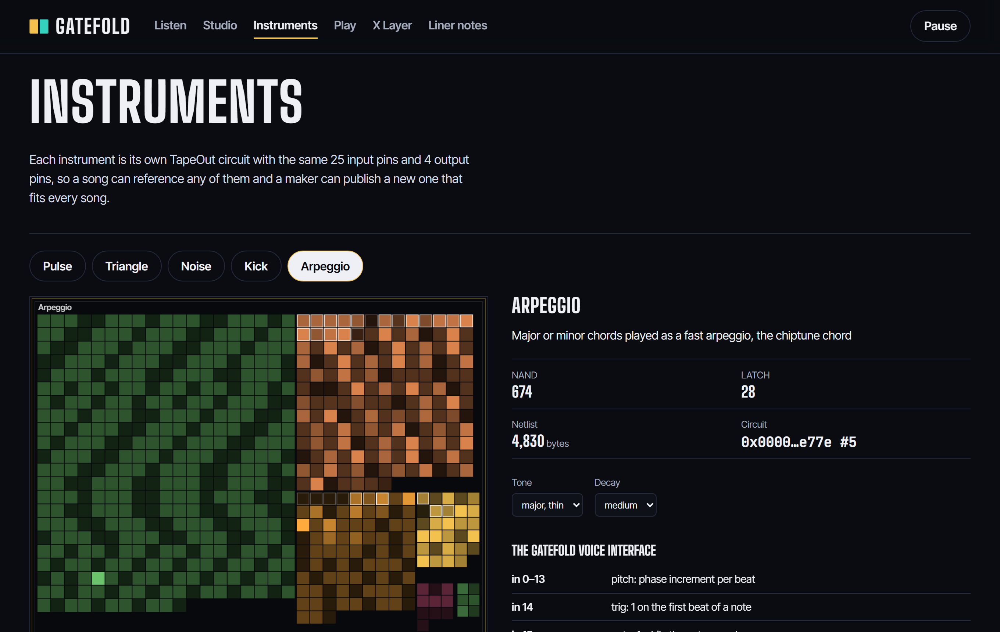
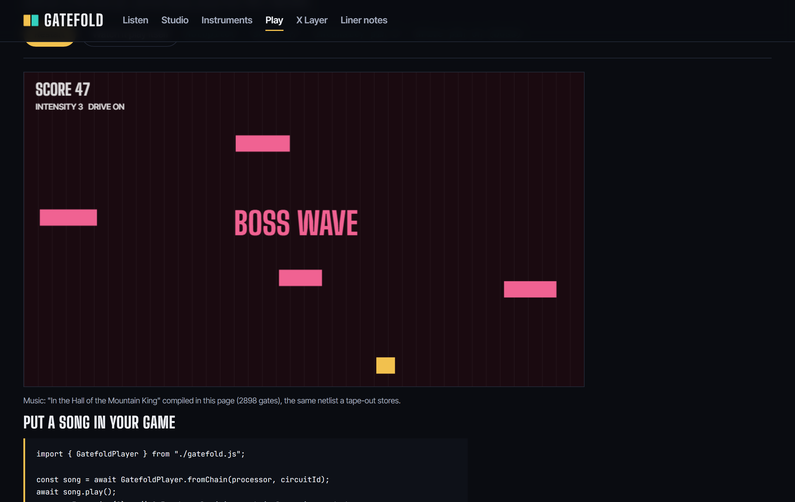
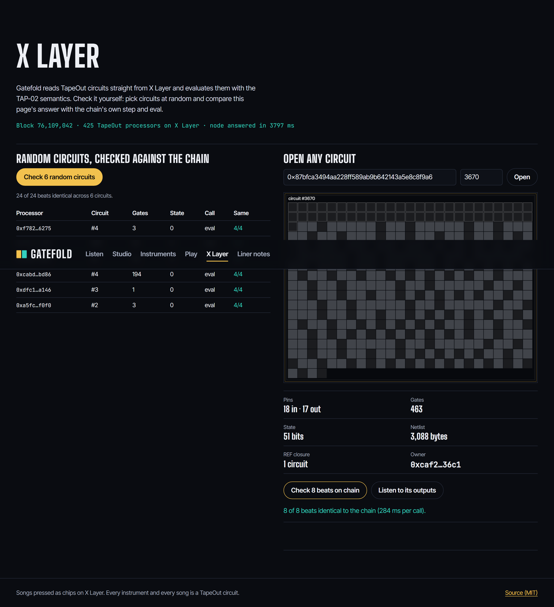
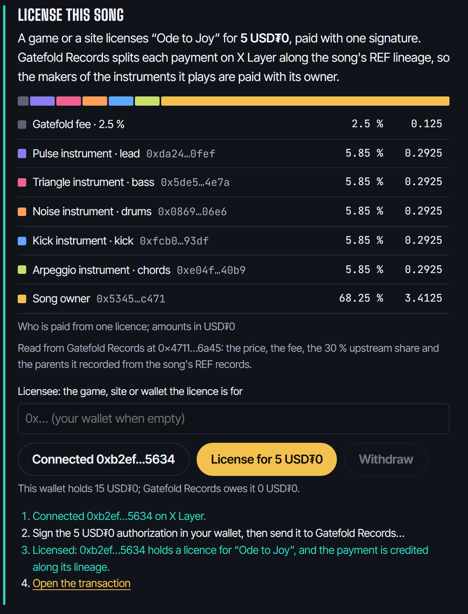

# Gatefold

**Songs pressed as chips on X Layer: a chiptune studio where every instrument and every song is a TapeOut circuit, so
the chain bytes are the song, a game can steer it while it plays, and each licence pays the makers of the instruments it
uses.**

[](https://github.com/Marc-Dvci/gatefold/actions/workflows/tests.yml)
[](https://github.com/Marc-Dvci/gatefold/actions/workflows/live.yml)
[](https://github.com/Marc-Dvci/gatefold/actions/workflows/codeql.yml)
[](#tests)
[](LICENSE)



| Live site | Built on | Headline |
|---|---|---|
| [marc-dvci.github.io/gatefold](https://marc-dvci.github.io/gatefold/) | TapeOut circuits (NAND, LATCH, REF), processor `step()`, DeWEB, X Layer, USD₮0 | A 27-second song is a 6,865-byte TAP-02 netlist, 352 times smaller than the same audio as a CD-quality WAV, and the processor's own `step()` computes the same samples as the player: 216 of 216 beats checked |

[For judges](#for-judges) · [See it work](#see-it-work) · [How it works](#how-it-works) ·
[TapeOut and X Layer](#how-tapeout-and-x-layer-are-used) · [Evidence](#evidence) · [Run it](#run-it)

## For judges

| Criterion | Where it is answered |
|---|---|
| User value and commercial potential | [The problem](#the-problem) · [Business model](#business-model) · the licence panel on every song [`src/web/views/licence.ts`](src/web/views/licence.ts) · the game demo [`src/web/views/play.ts`](src/web/views/play.ts) · the embed [`src/embed/index.ts`](src/embed/index.ts) |
| Innovation | Sound as a new medium for TapeOut circuits: the [compiler](src/core/song.ts#L157), the [ROM as a reduced decision diagram](src/core/arith.ts#L136-L177), REF composition of [instrument circuits](src/core/instruments.ts), and [royalties along the REF lineage](contracts/src/GatefoldRecords.sol#L248-L262) |
| Ecosystem integration | [How TapeOut and X Layer are used](#how-tapeout-and-x-layer-are-used) · [the full release, rehearsed on a fork of X Layer](docs/EVIDENCE.md#1-the-full-release-on-a-fork-of-x-layer-mainnet) · [the site written into a DeWEB container](scripts/deploy.ts#L662) |
| Product readiness and UX | Six pages ([screens](#see-it-work)) covering the whole journey: write, play, tape out, steer from a game, license, withdraw; [10 browser tests with axe-core](e2e/app.spec.ts), a [no-install quickstart](#run-it) and a Docker image |
| Demo video | [The film on YouTube, 2:24](https://youtu.be/TkMQJvZl_fs) |

## See it work



**The cover is the circuit.** Each cell is a gate of the song or of an instrument it references, lit when its value
changes. The oscillators shimmer at audio rate, the score ROMs change on every note, the envelopes pulse on each attack.
The page computes every gate, 24,000 times a second, from the same netlist a tape-out stores on X Layer.

<br clear="right">

| | |
|---|---|
|  |  |
| **Studio.** Each channel is a line of MML. Every edit recompiles the song into gates and plays the new circuit. | **Instruments.** Five instrument circuits with one pin layout. Every key press runs through the chosen circuit. |
|  |  |
| **Play.** A game drives the song's pins: the score raises the intensity, and a boss wave switches on the drive pin. | **X Layer.** Any visitor can check the player against the chain: random circuits, compared with the processor's own `step()`. |

## The problem

Music on chain today is a file. A file cannot react to a game, cannot show what it plays, and pays nobody when another
song reuses its sounds.

TapeOut makes logic a first-class object on X Layer: circuits of NAND and LATCH gates that any page can read and that
the processor recomputes on request. The census of X Layer at block 76,107,571 counts 11,573 circuits on 425
processors, and 3,004 of them hold state ([`tests/fixtures/xlayer-sample.json`](tests/fixtures/xlayer-sample.json)).

Gatefold is for two people:

- **The builder of a TapeOut game or DeWEB site** who wants music that lives on chain like the rest of the site, and
  that follows the game: calm while exploring, every channel in during a fight, faster in a boss wave.
- **The chiptune musician** who wants to publish a song or an instrument once, and be paid each time a game licenses
  it or another song is built on it.

## How it works


1. **Score.** Each channel is written in MML, the text notation chiptune composers have typed since the 1980s
   ([`src/core/mml.ts`](src/core/mml.ts)).
2. **Gates.** The compiler builds the song as NAND and LATCH gates: an envelope clock, a tick counter, a row counter,
   one ROM per channel and a mixer ([`src/core/song.ts`](src/core/song.ts#L157)). The gate builder folds constants and
   shares identical gates, so a ROM built from multiplexers becomes a reduced decision diagram of the score: a passage
   that repeats on an aligned block costs almost no new gates ([`src/core/net.ts`](src/core/net.ts),
   [`src/core/arith.ts`](src/core/arith.ts#L136-L177)).
3. **Instruments by reference.** Each channel drives an instrument circuit through a TAP-02 REF record. The five
   instruments share one pin layout, the Gatefold voice interface (25 inputs, 4 outputs), so a maker can publish a new
   instrument that fits every song ([`src/core/instruments.ts`](src/core/instruments.ts)).
4. **Tape-out.** One transaction stores a netlist on the Gatefold processor and mints it as a circuit NFT. TapeOut burns
   transistors only for a circuit's own gates, so a song pays for its sequencer and mixer, not for the instruments it
   references.
5. **Playback.** The player reads a song and its REF closure from X Layer, refuses anything above its gate and depth
   bounds (TAP-02 §7), inlines every REF instance with its own block of state, compiles the gates to straight-line
   JavaScript and runs them in an AudioWorklet: 24,000 beats a second, one beat per sample
   ([`src/core/flat.ts`](src/core/flat.ts), [`src/web/worklet.ts`](src/web/worklet.ts)).
6. **Proof.** Any beat of the player can be sent to the processor's own `step()` through `eth_call`; the chain returns
   the same next state and the same sample.
7. **Licences.** Gatefold Records reads a release's REF records from its on-chain netlist and records the released
   circuits it references as parents. A licence is paid in USD₮0 with one signed EIP-3009 authorization: a 2.5 % fee,
   then each release's upstream share split along the REF lineage, then the current owner of the circuit NFT
   ([`contracts/src/GatefoldRecords.sol`](contracts/src/GatefoldRecords.sol)).

## How TapeOut and X Layer are used

| Product | What it does in Gatefold | Why it is needed |
|---|---|---|
| TapeOut circuits: NAND, LATCH, REF | Every song and every instrument is a circuit. LATCH holds the oscillators, envelopes, noise registers and the song position; REF puts instruments inside songs | The audio is computed by the circuit, so the bytes on chain are the song |
| Processor `step()` and `eval()` | The player's beats are checked against the chain; the X Layer page lets any visitor do it on any circuit | It shows the player plays the chain's circuit, bit for bit |
| Processor factory, transistors, `tapeout` | The deploy script creates the Gatefold processor, mints NAND and LATCH transistors and tapes out 5 instruments and 3 songs | Each song and instrument is an NFT its maker owns; ownership decides who is paid |
| DeWEB and TapeKit | The site is written into the DeWEB container of the theme song's own circuit, read back byte for byte, and activated as `<id>.2.<processor>.tape`. Its only request goes to `https://rpc.xlayer.tech/`, which a TapeKit gateway counts as the site's own node | The studio, the player and the game run from chain bytes, with no server |
| X Layer and USD₮0 | Licences paid with one signed authorization (EIP-3009), the form OKX's x402 packages use for USD₮0 on X Layer | A game can license a song in one signature, and the split runs on chain |

## Business model



Every song page sells its own licence. The panel reads the song's release from Gatefold Records, shows who is paid
from one licence, and buys it with one signature from the visitor's wallet; a payee withdraws from the same panel
([`src/web/views/licence.ts`](src/web/views/licence.ts), [`src/chain/records.ts`](src/chain/records.ts)).

- **Transistors.** Gatefold runs its own processor; every song taped out on it burns transistors bought from it, at the
  price set when the processor is created.
- **Licence fee.** Gatefold Records keeps a fee on every licence: 2.5 % (250 basis points) in the deployment script,
  capped at 10 % by the contract.
- **An instrument market.** Instrument makers set an upstream share on songs that reference their circuits; every
  licence of such a song pays them through the lineage, and rights follow the circuit NFT when it is sold.

<br clear="right">

## Safe by design

- Every tape-out and every licence is signed in the visitor's own wallet, and payees withdraw what they are owed from
  the contract: the site holds no key.
- The player checks every netlist before it plays: up to 200,000 gates, REF nesting up to 16, and each netlist equal to
  the chain's own `circuitInfo`.
- A signed licence authorization is bound to one song and one licensee: its nonce is the hash of both, so a signature
  pays for that licence and no other ([tests](contracts/test/GatefoldRecords.t.sol)).

## Evidence

Every figure below comes from a run whose command is given; [`docs/EVIDENCE.md`](docs/EVIDENCE.md) has the details.

| What | Result | Command |
|---|---|---|
| The full release on a local fork of X Layer mainnet: processor, transistors, 5 instruments, 3 songs, Gatefold Records, releases, a USD₮0 licence, the site in a DeWEB container | 47 transactions, 77,966,906 gas; each song checked at 36 points of its first pass and loop, with two pin settings: **216 of 216 beats identical to the processor's `step()`**; a licence bought through the Listen page's own code: **6 payees credited exactly the split the page shows**; 12 site files (226,360 bytes) read back identical | `npx tsx scripts/deploy.ts --fork` |
| Gatefold's evaluators against X Layer mainnet, read-only | **80 circuits** (40 with state) on 48 processors: **320 of 320 beats identical**, for the reference evaluator and the compiled engines | `npx tsx scripts/conformance.ts` |
| The official TAP-02 reference implementation replaying the songs | **24,000 of 24,000 samples identical** for each of the 3 songs | `python scripts/crosscheck_reference.py` |
| Size of a song on chain | 6,865 / 6,600 / 5,906 bytes for 27.4 / 33.1 / 29.1 seconds: **352×, 442×, 434× smaller** than a CD-quality WAV | `npm run songs` |

What is real: every number above comes from X Layer mainnet or from a fork of it at a pinned block, and the songs are
the files in [`songs/`](songs/).

## Run it

> [!TIP]
> Nothing to install: open a ready environment in your browser, and the site starts by itself.
> [](https://codespaces.new/Marc-Dvci/gatefold?quickstart=1)

Node 22 or later.

```sh
npm ci
npm run dev            # http://localhost:5173
```

With Docker:

```sh
docker compose up      # http://localhost:8080
```

Hear the songs without running anything: [`examples/audio/`](examples/audio/) holds MP3s rendered from the circuits,
and [`examples/songs/`](examples/songs/) the netlists with their stats.

### Tests

| Suite | Count | Command |
|---|---|---|
| Unit and property tests (fast-check), random order | 181 | `npm test` |
| Browser tests on every page, with axe-core and a phone-width check | 10 | `npx playwright test` |
| Gatefold Records (Foundry), 2 fuzz tests at 1,024 runs each | 27 | `cd contracts && forge test` |
| TAP-02 reference replay of the songs | 3 songs × 24,000 samples | `python scripts/crosscheck_reference.py` |

Coverage of the core (`src/core`): 98.5 % of lines and 94.7 % of branches; of the chain client (`src/chain`): 97.6 % and
88.6 % (`npm run test:cov`). The tests run with no network and no keys: the chain client is tested on answers recorded
from X Layer mainnet ([`tests/fixtures/xlayer-rpc-recording.json`](tests/fixtures/xlayer-rpc-recording.json)).

### Press it on X Layer

```sh
cd contracts && forge build && cd ..
npx tsx scripts/deploy.ts --fork               # rehearsal on a local fork, no funds
npx tsx scripts/deploy.ts --live               # prints the plan
GATEFOLD_DEPLOYER_KEY=… npx tsx scripts/deploy.ts --live --yes
```

The live run writes [`deployments/xlayer.json`](deployments/xlayer.json), which the site reads.

## Claims and the tests that hold them

| Claim | Code | Test |
|---|---|---|
| The TAP-02 codec and evaluator follow the standard | [`src/core/tap02.ts`](src/core/tap02.ts) | the published vectors in [`tests/tap02.test.ts`](tests/tap02.test.ts) |
| The compiled engines give the same outputs and state as the reference evaluator | [`src/core/flat.ts`](src/core/flat.ts) | property tests on random circuits with LATCH and REF, [`tests/flat.test.ts`](tests/flat.test.ts) |
| A repeated aligned passage adds almost no gates | [`src/core/arith.ts`](src/core/arith.ts) | [`tests/net.test.ts`](tests/net.test.ts), [`tests/music.test.ts`](tests/music.test.ts) |
| Each instrument plays its note within 0.3 % | [`src/core/instruments.ts`](src/core/instruments.ts) | [`tests/music.test.ts`](tests/music.test.ts) |
| Intensity and drive pins change what plays | [`src/core/song.ts`](src/core/song.ts) | [`tests/music.test.ts`](tests/music.test.ts), [`e2e/app.spec.ts`](e2e/app.spec.ts) |
| Credits of a licence always add up to its price | [`contracts/src/GatefoldRecords.sol`](contracts/src/GatefoldRecords.sol) | `testFuzz_credits_add_up_to_the_price` |
| The split the Listen page shows is the split the contract pays | [`src/chain/records.ts`](src/chain/records.ts) | [`tests/records.test.ts`](tests/records.test.ts) and the fork rehearsal, which buys the licence through the page's code and checks every payee |
| The page's licence signature is the one USD₮0 verifies | same | `signs one USD₮0 authorization bound to the song and the licensee` in [`tests/records.test.ts`](tests/records.test.ts) |
| A signed authorization cannot be redirected or replayed | same | `test_a_signed_authorization_cannot_be_redirected_to_another_licensee`, `test_a_signed_authorization_cannot_be_replayed` |
| The chain computes the same beats as the player | [`scripts/deploy.ts`](scripts/deploy.ts), [`scripts/conformance.ts`](scripts/conformance.ts) | the fork rehearsal and the daily [live workflow](.github/workflows/live.yml) |

## Layout

```
src/core/       TAP-02 codec and evaluator, gate builder, word-level blocks, compiled engines, instruments, MML, songs
src/chain/      JSON-RPC, ABI, processor reads, the tape-out and licence paths through a wallet
src/web/        the site: Listen, Studio, Instruments, Play, X Layer, Liner notes; the AudioWorklet; the die view
src/embed/      the player a game or site copies into its own files
contracts/      Gatefold Records (Solidity, Foundry)
scripts/        deploy (fork or live), conformance, song export, the TAP-02 reference replay
songs/          the three songs, in MML
third_party/    the TAP-02 test vectors and reference implementation, unchanged
```

The songs: "Gatefold" is an original theme written for this project; "In the Hall of the Mountain King" (Grieg, 1875)
and "Ode to Joy" (Beethoven, 1824) are public-domain works, arranged here. Code under the [MIT licence](LICENSE); fonts
under the SIL Open Font License ([`web/public/fonts/README.md`](web/public/fonts/README.md)).
